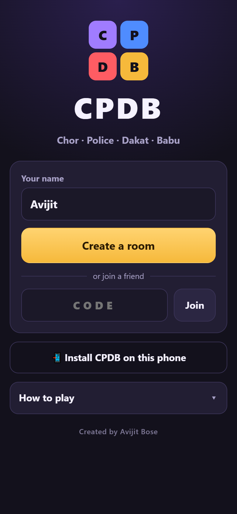
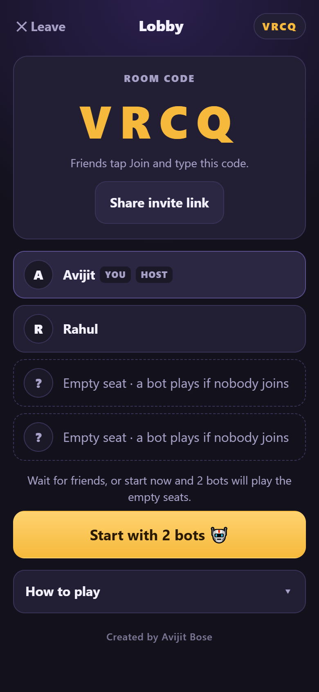
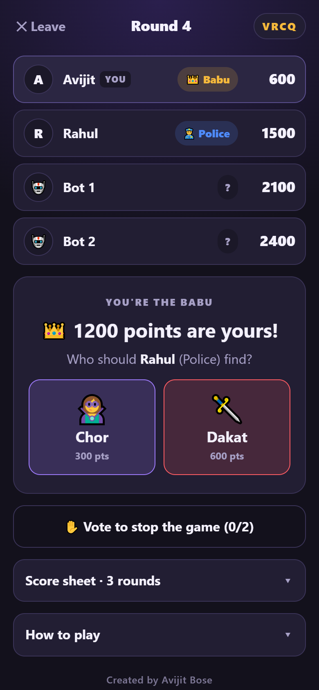
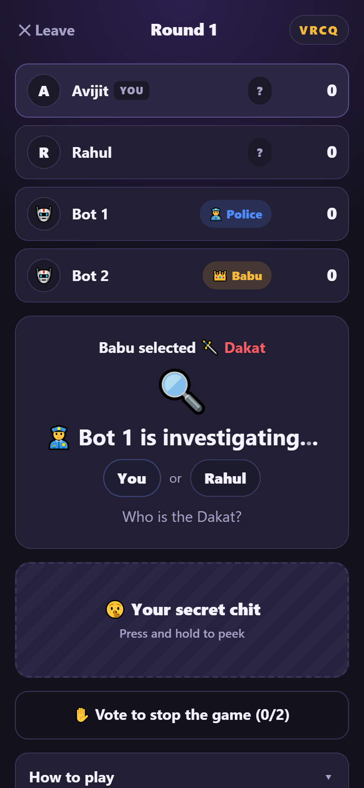
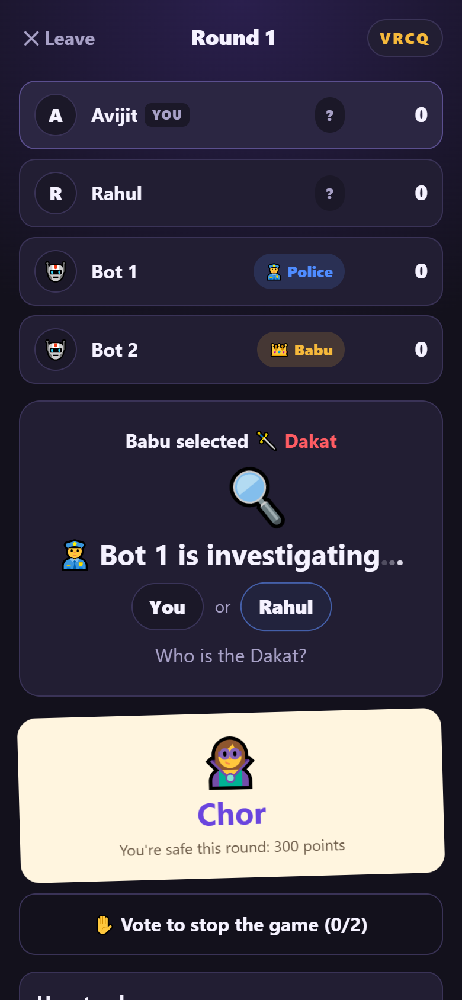
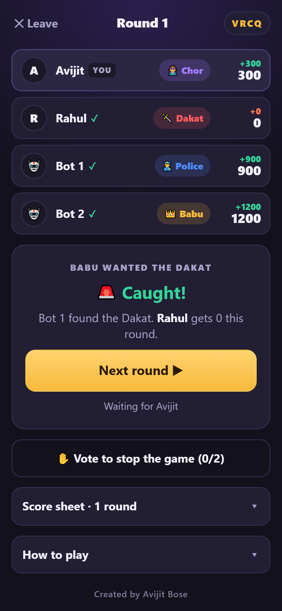
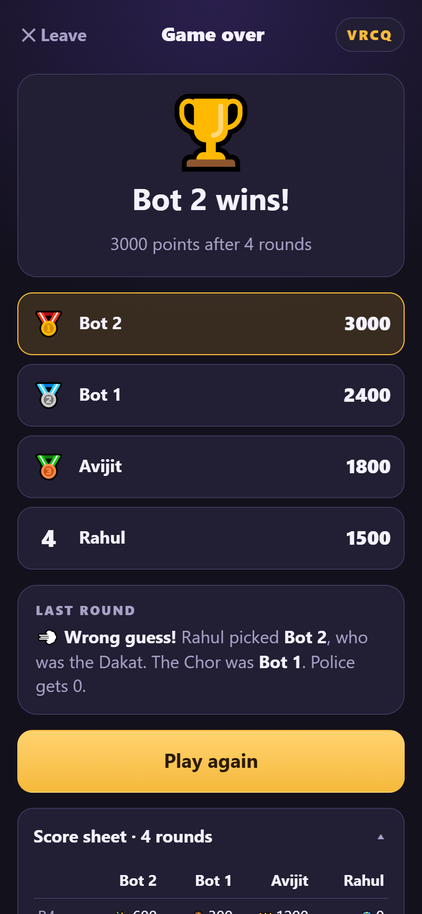

# CPDB: Chor Police Dakat Babu

The classic chit game **Chor, Police, Dakat, Babu**, made for phones. Four players, everyone on their own phone, no paper chits needed. Short of friends? Bots fill the empty seats.

### ▶ Play now: **https://chor-police-dakat-babu.onrender.com**

Free, nothing to download, works in any phone browser. If nobody has played for a while, the first load can take up to a minute while the server wakes up.

  
  
  
  

  
  
  
  

## Start a game

1. Open the link and type your name.
2. One player taps **Create a room** and gets a 4-letter room code.
3. Everyone else types that code and taps **Join**. You can also tap **Share invite link** to send it on WhatsApp.
4. The host taps **Start game**. With fewer than 4 people the button says **Start with 2 bots** (or 1, or 3), and bots take the empty seats.

## The chits

| Chit | Points | Who knows |
|---|---|---|
| 👑 Babu | 1200 | Everyone |
| 👮 Police | 900 | Everyone |
| 🗡️ Dakat | 600 | Only the player holding it |
| 🦹 Chor | 300 | Only the player holding it |

## How a round goes

1. **Shuffle.** The chits are shuffled and everyone gets a new one at random.
2. **The Babu chooses.** The Babu gets 1200 points for free and picks who the Police must find: the Chor or the Dakat. Everyone sees the choice, like "Babu selected Chor".
3. **The Police investigates.** The Police picks which of the two hidden players has that chit. Everyone else watches the 🔍 while the Police decides.
4. **The result.**
   - **Right guess:** the Police gets 900, the caught player gets 0, and the other hidden player keeps their points.
   - **Wrong guess:** the Police gets 0, and the Chor and the Dakat both keep their points.
5. When everyone taps **Next round**, the next shuffle starts. Points add up round after round.

**Your secret chit:** if you're the Chor or the Dakat, your chit stays covered so nobody can read it off your screen. Press and hold it to peek.

## Ending the game

Play as many rounds as you like. Anyone can tap **Vote to stop the game** at any time, and tap again to undo. When every player has voted, the current round finishes and the game ends. The highest total wins, and players with the same score share the place. The score sheet shows every round.

The host can tap **Play again** to start a new game with the same room.

## Playing with bots

- With 1, 2 or 3 people, bots called **Bot 1**, **Bot 2** and **Bot 3** 🤖 fill the empty seats.
- Bots get chits and points like everyone else, and they can win.
- A bot Babu or bot Police picks at random after a short pause, so bots never cheat.
- Bots are always ready for the next round and never vote, so the people decide when the game ends.
- **Play again** removes the bots, so more friends can join before the next game.

## Add it to your home screen (Android)

Open the link in Chrome and tap **Install CPDB on this phone** on the start screen, or **⋮ → Add to Home screen**. It gets its own icon and opens full screen like a normal app.

## Good to know

- **Phone locked or page reloaded?** The game reconnects you to your seat by itself.
- **Switched phones?** Join the same room code with the same name and you get your seat back, points and all.
- **Someone dropped out before the start?** In the lobby, the host can remove a player who went offline.
- **No cheating:** nobody's phone is told who the Chor and the Dakat are until the round is over, so even inspecting the page won't reveal them.
- The screen stays on while you're in a room, and your phone buzzes when it's your turn.

## Project files

| File | What it does |
|---|---|
| `server.js` | Web server and rooms (WebSockets) |
| `game.js` | Game rules, scoring and bots |
| `public/` | The phone app: page, styles, script, icons |
| `test/play.js` | Test players and bots play scripted games and check the rules (`npm test`) |
| `scripts/make-icons.ps1` | Redraws the app icons |
| `scripts/screenshots.js` | Retakes the screenshots above in headless Chrome |

---

Created by <b>Avijit Bose</b>

